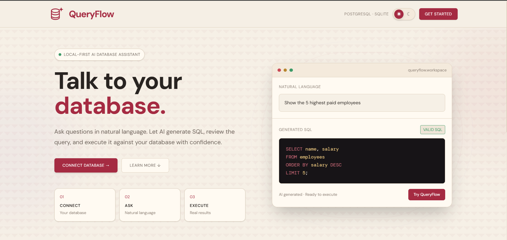
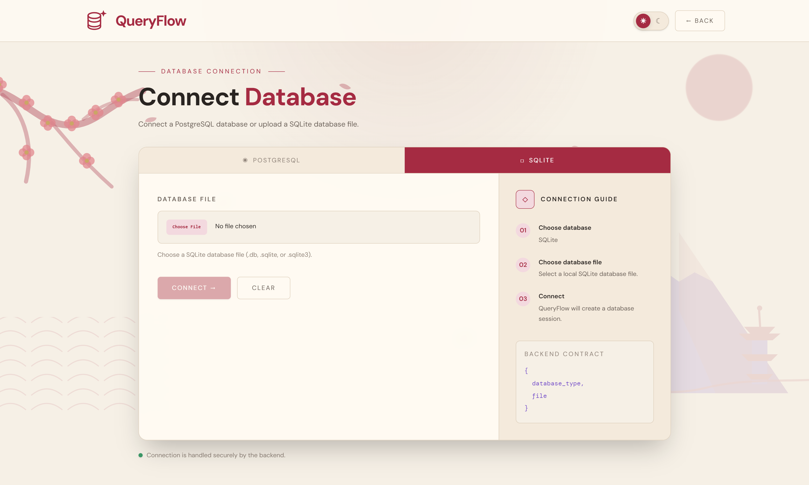
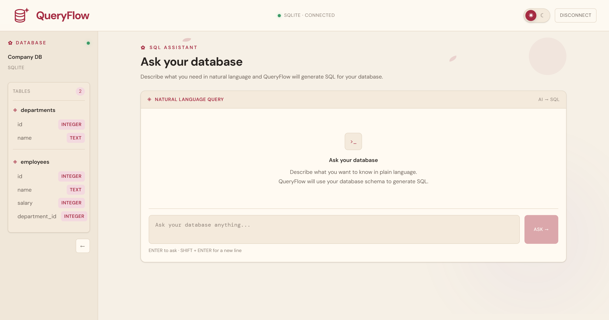

# QueryFlow

QueryFlow lets you ask questions about a database in plain language. It uses the connected database schema to generate SQL, then lets you review and run the query.

QueryFlow currently supports SQLite and PostgreSQL. SQL generation uses Google Gemini.

## Demo

- **Web app:**

## Features

- Upload a SQLite database or connect to PostgreSQL.
- Browse tables, columns, and relationships in the database schema.
- Ask questions in natural language and generate SQL with Gemini.
- Review and edit generated SQL before execution.
- View query results in the workspace.
- Use light or dark theme.

## How it works

1. Connect a database.
2. QueryFlow reads its schema and makes it available to the SQL-generation service.
3. Ask a question; Gemini returns a query and a short explanation.
4. Review or edit the query and execute it.

The API uses SQLAlchemy adapters for SQLite and PostgreSQL. The AI provider is isolated behind an `AIService` interface, which allows deterministic tests to use a mock service.

## SQL safety

Before execution, SQL is parsed with `sqlglot`. The API accepts one statement whose top-level type is `SELECT` and rejects other statement types and multiple statements. The AI prompt also requests read-only SQL, but execution validation is the enforcement layer.

For additional protection, connect with a database account that has read-only permissions. Natural-language questions and schema details are sent to Google Gemini when SQL generation is requested.

## Run locally

### Requirements

- Python 3.12 or newer
- Node.js and npm
- A Gemini API key for SQL generation
- A PostgreSQL database, if you want to use PostgreSQL

### Backend

From the project root:

```powershell
cd server
py -m venv .venv
.\.venv\Scripts\Activate.ps1
python -m pip install -r requirements.txt
Copy-Item .env.example .env
```

Add your Gemini API key to `server/.env`:

```env
GEMINI_API_KEY=your_gemini_api_key
GEMINI_MODEL=gemini-3.5-flash-lite
```

Start the API from the `server` directory:

```powershell
uvicorn app.main:app --reload
```

The API runs at `http://127.0.0.1:8000`. Open `http://127.0.0.1:8000/docs` for interactive API documentation.

### Frontend

In a second terminal, from the project root:

```powershell
cd client
npm install
npm run dev
```

Open the local URL printed by Vite, usually `http://localhost:5173`. The client defaults to `http://127.0.0.1:8000` for its API. To change it, set `VITE_API_BASE_URL` in `client/.env`.

### Run tests

From the `server` directory:

```powershell
python -m pytest
```

PostgreSQL integration tests require `TEST_POSTGRES_URL` in `server/.env`; they are skipped when it is not set.

## API overview

| Method | Endpoint | Purpose |
| --- | --- | --- |
| `GET` | `/` | Health check |
| `POST` | `/database/session` | Create a SQLite or PostgreSQL session |
| `POST` | `/database/schema?session_id={id}` | Retrieve the connected database schema |
| `POST` | `/generate` | Generate SQL from a question and session ID |
| `POST` | `/database/execute` | Validate and execute a SQL query |

## Project structure

```text
client/       React and Vite frontend
server/       FastAPI backend and tests
  app/        API routes, AI services, database adapters, and models
  tests/      API and database tests
database/     Sample SQLite database
scripts/      Demo database setup script
assets/       Screenshots and workflow demos
```

## Screenshots

| Home | Database connection | Query workspace |
| --- | --- | --- |
|  |  |  |

## License

QueryFlow is available under the [MIT License](LICENSE).
